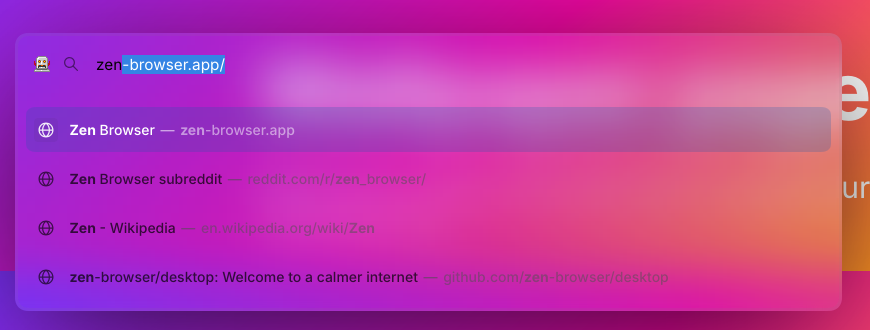
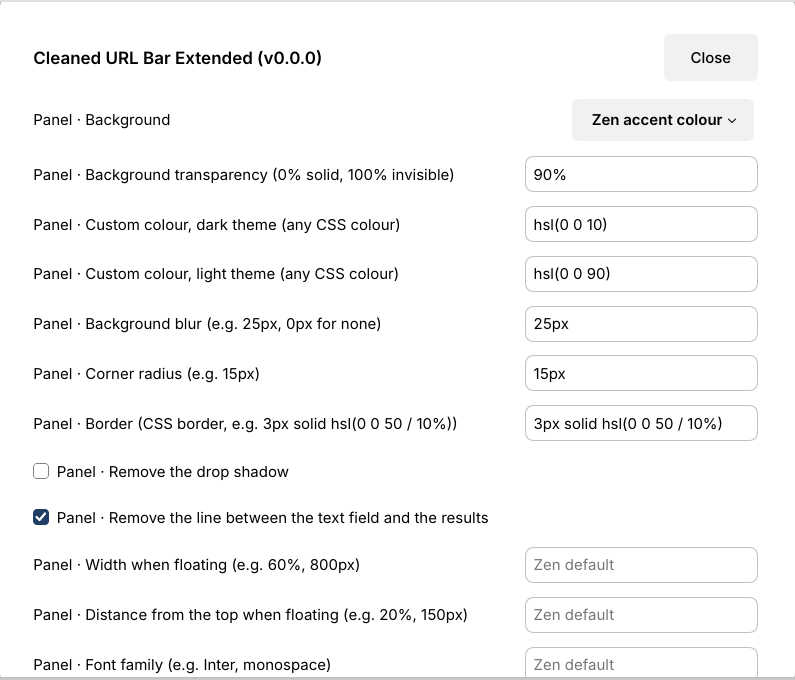
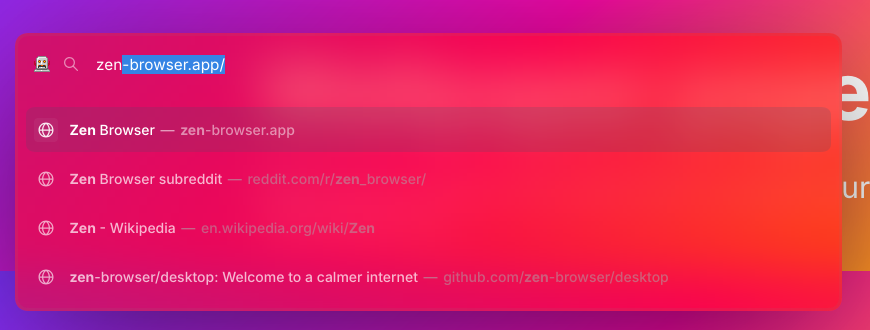

# Cleaned URL Bar Extended

A clean, glassy URL bar for [Zen Browser](https://zen-browser.app/) where **everything about the
URL bar can be personalised**: its look (colours, transparency, blur, fonts, sizes, icons) and its
behaviour (floating or not, which suggestions appear, how many results, how addresses are shown...),
including the URL bar options that normally only exist in `about:config`.



It started as a fork of [Zen Cleaned URL Bar](https://github.com/dinnoyow/zen-cleaned-url-bar), which
is no longer maintained, and builds on the fixes of
[Better Cleaned URL Bar](https://github.com/matteo-tafuro/zen-better-cleaned-url-bar) (see [Credits](#credits)).

## Install

Close Zen, then run in a terminal (Linux or macOS):

```sh
curl -fsSL https://raw.githubusercontent.com/andres-pixel35/zen-cleaned-url-bar-extended/main/install.sh | bash
```

That's all: the script finds your Zen profile, installs the mod and keeps any settings you already
had. Start Zen and the new URL bar appears a moment after startup. At the end it offers to walk you
through the URL bar's behaviour options (you can do that any time later with `configure.sh`).

If you use several Zen profiles (or Zen and Zen Twilight), the script asks which one to use. To
choose the profile yourself, pass its folder with `-p` (in Zen: `about:support` > **Profile
Directory**):

```sh
curl -fsSL https://raw.githubusercontent.com/andres-pixel35/zen-cleaned-url-bar-extended/main/install.sh | bash -s -- -p "/path/to/your/profile"
```

`-p` also accepts the Zen folder that contains `profiles.ini` (for example `~/.zen`).

### Update, configure, uninstall

| What | Command |
|---|---|
| Update to the latest version (keeps your settings) | `curl -fsSL https://raw.githubusercontent.com/andres-pixel35/zen-cleaned-url-bar-extended/main/update.sh \| bash` |
| Answer questions about the URL bar's behaviour | `curl -fsSL https://raw.githubusercontent.com/andres-pixel35/zen-cleaned-url-bar-extended/main/configure.sh \| bash` |
| Show the current behaviour settings | `curl -fsSL https://raw.githubusercontent.com/andres-pixel35/zen-cleaned-url-bar-extended/main/configure.sh \| bash -s -- --list` |
| Uninstall | `curl -fsSL https://raw.githubusercontent.com/andres-pixel35/zen-cleaned-url-bar-extended/main/uninstall.sh \| bash` |
| Uninstall and put the URL bar preferences back to Zen's defaults | `curl -fsSL https://raw.githubusercontent.com/andres-pixel35/zen-cleaned-url-bar-extended/main/uninstall.sh \| bash -s -- --reset-prefs` |

Every script accepts `-p <folder>` and `--help`. You can also clone the repository and run the
scripts directly (`./install.sh`, `./configure.sh`, ...).

**Zen must be closed** while a script changes something: Zen rewrites its settings files when it quits,
which would undo the changes. If Zen is open, the script asks you to close it and waits.

The scripts find profiles in these places: `~/.zen` and `~/.config/zen` (Linux),
`~/.var/app/app.zen_browser.zen/` (Flatpak) and `~/Library/Application Support/zen` (macOS).
They need only `bash` (3.2 or newer, so the one built into macOS works), `curl`, `tar` and the usual
system tools; no jq or python.

<details>
<summary>Windows, or installing by hand</summary>

The scripts are for Linux and macOS. On Windows (or to do it yourself):

1. In Zen open `about:support` and open the **Profile Directory**. Close Zen.
2. Create the folder `chrome/zen-themes/zen-cleaned-url-bar-extended` inside the profile and copy
   `chrome.css`, `preferences.json` and `readme.md` from this repository into it.
3. Open `zen-themes.json` in the profile (create it with `{}` if it does not exist) and add the content
   of [`theme.json`](theme.json) as a new entry with the key `"zen-cleaned-url-bar-extended"` and an
   extra `"enabled": true`.
4. Start Zen, open `about:config` and delete `zen.mods.last-update` (this makes Zen rebuild its mod
   stylesheet right away; otherwise toggle any mod setting in Settings > Zen Mods).
</details>

## Customise

### Look: Settings > Zen Mods > Cleaned URL Bar Extended



Every look option is in Zen's mod settings and applies instantly. Text fields that show
**Zen default** keep Zen's own style while they are empty, so you only change what you want. Sizes and
colours accept any CSS value (`12px`, `1.2em`, `#ff8800`, `rgb(...)`, `hsl(...)`, `light-dark(...)`).

| Setting | Default |
|---|---|
| Panel · Background | Zen accent colour |
| Panel · Background transparency (0% solid, 100% invisible) | `90%` |
| Panel · Custom colour, dark theme (any CSS colour) | `hsl(0 0 10)` |
| Panel · Custom colour, light theme (any CSS colour) | `hsl(0 0 90)` |
| Panel · Background blur (e.g. 25px, 0px for none) | `25px` |
| Panel · Corner radius (e.g. 15px) | `15px` |
| Panel · Border (CSS border, e.g. 3px solid hsl(0 0 50 / 10%)) | `3px solid hsl(0 0 50 / 10%)` |
| Panel · Remove the drop shadow | off |
| Panel · Remove the line between the text field and the results | on |
| Panel · Width when floating (e.g. 60%, 800px) | empty (Zen default) |
| Panel · Distance from the top when floating (e.g. 20%, 150px) | empty (Zen default) |
| Panel · Font family (e.g. Inter, monospace) | empty (Zen default) |
| Panel · Typed text size (e.g. 18px) | empty (Zen default) |
| Panel · Typed text colour | empty (Zen default) |
| Results · Row corner radius (e.g. 11px) | `11px` |
| Results · Fade the highlight in and out smoothly | on |
| Results · Row height (e.g. 38px) | empty (Zen default) |
| Results · List max height before scrolling (e.g. 400px, none) | empty (Zen default) |
| Results · Text size (e.g. 13px) | empty (Zen default) |
| Results · Title colour | empty (Zen default) |
| Results · Address colour | empty (Zen default) |
| Results · Hover background colour | empty (Zen default) |
| Results · Dim addresses to make titles stand out | on |
| Results · Hide addresses, show titles only | off |
| Selected result · Background | Zen accent colour (softened) |
| Selected result · Background transparency (0% solid, 100% invisible) | `70%` |
| Selected result · Custom background colour | `hsl(0 0 80)` |
| Selected result · Text colour | empty (Zen default) |
| Selected result · Icon background | Subtle tint |
| Resting bar · Background colour | empty (Zen default) |
| Resting bar · Corner radius | empty (Zen default) |
| Resting bar · Border (CSS border) | empty (Zen default) |
| Resting bar · Font family | empty (Zen default) |
| Resting bar · Text size | empty (Zen default) |
| Resting bar · Text colour | empty (Zen default) |
| Resting bar · Centre the address | off |
| Icons · Hide the site information (lock) icon | off |
| Icons · Hide Zen's site data / extensions button | off |
| Icons · Hide granted-permission icons | off |
| Icons · Show the reader view button (when available) | off |
| Icons · Show the bookmark star | off |
| Icons · Hide the zoom level indicator | off |
| Icons · Hide the translations button | off |
| Icons · Hide the split view button | off |
| Icons · Hide the copy URL button | off |
| Search buttons row · Rounded, borderless style | on |

The panel is the URL bar while it is open (expanded in place or floating); the resting bar is the
URL bar when it is not focused (in the sidebar or the top toolbar).



### Behaviour: `configure.sh` or Zen's mod settings

The URL bar's behaviour comes from Zen's own preferences (the ones in `about:config`). The mod puts
the on/off and choice ones in its settings page too (below the look options), and `configure.sh` asks
about all of them, including the numbers Zen's settings page cannot edit (how many results, delays...).
These are normal Zen preferences: they stay when the mod is disabled or removed, unless you uninstall
with `--reset-prefs`.

<details>
<summary>All behaviour preferences</summary>

**Opening and behaviour**

| Preference | Zen default | Where |
|---|---|---|
| `zen.urlbar.behavior`: How should the URL bar open? | Float when opened with the keyboard (Ctrl+L, Ctrl+T), expand in place when clicked | configure.sh, Zen settings |
| `zen.urlbar.replace-newtab`: Open the URL bar instead of a blank page when you open a new tab? | on | configure.sh, Zen settings |
| `zen.urlbar.wait-to-clear`: How long, in milliseconds, should Zen remember what you typed in a new-tab URL bar you dismissed? | 45000 | configure.sh |
| `zen.urlbar.open-on-startup`: Open the URL bar automatically when Zen starts on an empty tab? | on | configure.sh, Zen settings |
| `browser.urlbar.openintab`: Open what you pick in the URL bar in a new tab instead of the current one? | off | configure.sh, Zen settings |
| `browser.urlbar.switchTabs.adoptIntoActiveWindow`: When a "Switch to tab" result belongs to another window, move that tab into the current window? | off | configure.sh, Zen settings |
| `zen.urlbar.enable-overrides`: Let Shift, Alt or Ctrl change what the selected result does? | off | configure.sh, Zen settings |
| `browser.urlbar.closeOnWindowBlur`: Close the URL bar dropdown when the Zen window loses focus? | off | configure.sh, Zen settings |
| `browser.urlbar.focusContentDocumentOnEsc`: Move focus back to the page when you press Esc in an empty URL bar? | on | configure.sh, Zen settings |

**Address display**

| Preference | Zen default | Where |
|---|---|---|
| `zen.urlbar.show-domain-only-in-sidebar`: In the single-toolbar layout, show only the domain (example.com) instead of the full address? | on | configure.sh, Zen settings |
| `browser.urlbar.trimURLs`: Hide "http://" and trailing slashes in addresses? | on | configure.sh, Zen settings |
| `browser.urlbar.trimHttps`: Also hide "https://"? | on | configure.sh, Zen settings |
| `browser.urlbar.trimWww`: Hide a leading "www."? | off | configure.sh, Zen settings |
| `browser.urlbar.untrimOnUserInteraction.featureGate`: Show the full address (with https://) as soon as you click into the URL bar? | on | configure.sh, Zen settings |
| `browser.urlbar.decodeURLsOnCopy`: Copy addresses in readable form (for example a space instead of %20)? | off | configure.sh, Zen settings |

**Buttons and icons**

| Preference | Zen default | Where |
|---|---|---|
| `zen.urlbar.show-protections-icon`: Show the tracking-protection shield icon? | off | configure.sh, Zen settings |
| `zen.urlbar.show-pip-button`: Show the Picture-in-Picture button when a page plays video? | off | configure.sh, Zen settings |
| `zen.urlbar.show-contextual-id`: Show the container label when a tab is in a container? | off | configure.sh, Zen settings |
| `zen.urlbar.single-toolbar-show-copy-url`: Show the "Copy URL" button in the single-toolbar layout? | on | configure.sh, Zen settings |
| `browser.urlbar.share-button.enabled`: Show the Share button? | off | configure.sh, Zen settings |
| `zen.theme.acrylic-urlbar`: Use Zen's own frosted-glass background for the open URL bar? | off | configure.sh, Zen settings |

**Suggestions**

| Preference | Zen default | Where |
|---|---|---|
| `browser.urlbar.suggest.history`: Suggest pages from your browsing history? | on | configure.sh, Zen settings |
| `browser.urlbar.suggest.bookmark`: Suggest bookmarks? | on | configure.sh, Zen settings |
| `browser.urlbar.suggest.openpage`: Suggest tabs you already have open ("Switch to tab")? | on | configure.sh, Zen settings |
| `browser.urlbar.suggest.remotetab`: Suggest tabs open on your other synced devices? | on | configure.sh, Zen settings |
| `zen.urlbar.show-pinned`: When the URL bar is empty, include your pinned shortcuts? | on | configure.sh, Zen settings |
| `zen.urlbar.show-sponsored`: When the URL bar is empty, include sponsored shortcuts? | off | configure.sh, Zen settings |
| `browser.urlbar.suggest.engines`: Suggest search engines whose name or keyword matches what you type (tab-to-search)? | on | configure.sh, Zen settings |
| `browser.urlbar.suggest.clipboard`: Suggest the link you just copied? | on | configure.sh, Zen settings |
| `browser.urlbar.suggest.calculator`: Show a calculator result when you type a math expression? | on | configure.sh, Zen settings |
| `browser.urlbar.unitConversion.enabled`: Show unit conversions (for example "10 km to mi")? | on | configure.sh, Zen settings |
| `browser.urlbar.suggest.recentsearches`: Suggest your recent searches when the URL bar is empty? | on | configure.sh, Zen settings |
| `browser.urlbar.recentsearches.maxResults`: How many recent searches should be shown at most? | 5 | configure.sh |
| `browser.urlbar.quickactions.enabled`: Enable Firefox quick actions (for example "Settings", "Clear history", "Downloads")? | on | configure.sh, Zen settings |
| `browser.urlbar.suggest.quickactions`: Show quick actions among normal results? | on | configure.sh, Zen settings |
| `zen.urlbar.suggestions.quick-actions`: Suggest Zen commands (for example "Toggle compact mode", "New split view")? | on | configure.sh, Zen settings |
| `browser.urlbar.contextualSearch.enabled`: Offer to search the current site when it has its own search engine? | on | configure.sh, Zen settings |
| `browser.urlbar.autoFill`: Autocomplete addresses inline as you type? | on | configure.sh, Zen settings |
| `browser.urlbar.groupLabels.enabled`: Show group headings above kinds of results? | off | configure.sh, Zen settings |
| `browser.urlbar.deduplication.enabled`: Merge history results that only differ by their #anchor? | on | configure.sh, Zen settings |
| `browser.urlbar.maxRichResults`: How many results should the dropdown show at most? | 10 | configure.sh |

**Search**

| Preference | Zen default | Where |
|---|---|---|
| `keyword.enabled`: Search with your default engine when what you type is not an address? | on | configure.sh, Zen settings |
| `browser.search.suggest.enabled`: Ask your search engine for suggestions as you type? | off | configure.sh, Zen settings |
| `browser.urlbar.suggest.searches`: Show those search suggestions in the URL bar? | on | configure.sh, Zen settings |
| `browser.urlbar.showSearchSuggestionsFirst`: Show search suggestions above history and bookmarks? | on | configure.sh, Zen settings |
| `browser.search.suggest.enabled.private`: Also show search suggestions in private windows? | off | configure.sh, Zen settings |
| `browser.urlbar.richSuggestions.tail`: Show "tail" suggestions that complete only the end of a long query? | on | configure.sh, Zen settings |
| `browser.formfill.enable`: Remember search and form history? | off | configure.sh, Zen settings |
| `browser.urlbar.maxHistoricalSearchSuggestions`: How many of your past searches should be suggested at most? | 2 | configure.sh |
| `zen.urlbar.hide-one-offs`: Hide the row of search-engine buttons at the bottom of the dropdown? | on | configure.sh, Zen settings |
| `browser.urlbar.shortcuts.bookmarks`: Show a "search bookmarks" button in that row? | on | configure.sh, Zen settings |
| `browser.urlbar.shortcuts.tabs`: Show a "search tabs" button in that row? | on | configure.sh, Zen settings |
| `browser.urlbar.shortcuts.history`: Show a "search history" button in that row? | on | configure.sh, Zen settings |
| `browser.urlbar.shortcuts.workspaces`: Show a "search workspaces" button in that row? | on | configure.sh, Zen settings |
| `browser.fixup.dns_first_for_single_words`: Treat a single word (like "router") as a local host name before searching for it? | off | configure.sh, Zen settings |
| `browser.urlbar.dnsResolveSingleWordsAfterSearch`: After you search a single word, check if it is also a local host and offer "Did you mean to go to ..."? | Never | configure.sh |

**Advanced**

| Preference | Zen default | Where |
|---|---|---|
| `browser.urlbar.speculativeConnect.enabled`: Pre-connect to the likely destination while you type? | on | configure.sh, Zen settings |
| `browser.urlbar.ctrlCanonizesURLs`: Make Ctrl+Enter turn "example" into "www.example.com"? | on | configure.sh, Zen settings |
| `browser.urlbar.delay`: How long, in milliseconds, to wait after you stop typing before updating results? | 50 | configure.sh |

</details>

Notes:
- Some preferences only matter together, and `configure.sh` skips questions that do not apply (for
  example search suggestions need `browser.search.suggest.enabled`, which Zen turns off by default).
- Hiding or showing the search-engine buttons row (`zen.urlbar.hide-one-offs`) takes effect after a
  restart of Zen.
- Zen locks a few URL bar preferences (sponsored "quick suggest" results and top-site suggestions), and
  turns off the services behind others (trending searches, weather, Firefox Suggest), so they are not
  offered here.

### Handy URL bar shortcuts

Start what you type with one of these characters and a space to search only one kind of result:
`*` bookmarks, `%` open tabs, `^` history, `?` search engine, `>` quick actions, `` ` `` workspaces,
`#` page titles, `$` addresses.

## How it works

- Zen loads mods from `chrome/zen-themes/<id>/` inside your profile and lists them in
  `zen-themes.json`. The installer puts the mod there and registers it.
- Zen only rebuilds its combined mod stylesheet (`chrome/zen-themes.css`) when a mod changes, or when
  its mod-update check runs at startup, which happens whenever `zen.mods.last-update` is unset. The
  scripts clear it, so the change shows up a moment after the next start. (That check also looks for
  updates of your other mods, as Zen does on its own every few weeks.)
- The mod's options are preferences named `mod.cleanedurlbarext.*`. The installer writes their default
  values; Zen's settings page then edits them. Text options reach the CSS as variables, and every
  rule is wrapped in `@media -moz-pref(...)`, which is why an empty field means "Zen default".
- Before changing `prefs.js` or `zen-themes.json` the scripts save a copy next to them, ending in
  `.cleanedurlbarext.bak`.
- This mod is not in Zen's theme store, so Zen's automatic mod updates do not touch it; use
  `update.sh` to update.

## What's fixed compared to the original

- **Blur works again** on Zen 1.19.9b and newer (Firefox 150+), which stopped `backdrop-filter` from
  seeing the page behind the URL bar. The fix (found by matteo-tafuro) is only applied while a blur is
  set.
- **Selectors updated** for current Zen: `.urlbar-background` (was `#urlbar-background`) and
  `[breakout-extend]` without a value (Zen 1.21.2b+), also from matteo-tafuro's fork.
- **The line between the text field and the results is removed again**: the original removed it
  through `.urlbarView-body-inner`, an element Firefox no longer has.
- **Dark mode colours follow Zen's theme**: the custom colours use `light-dark()`, so they follow the
  theme chosen in Zen even when it differs from the system theme (`prefers-color-scheme` does not).
- **Icons on a selected result stay readable** with the subtle or transparent icon background (Zen
  paints them in a dark colour meant for its white tile).
- **No dependency on the mod's display name**: options use `-moz-pref()` instead of the hidden element
  Zen names after the mod, and the Zen-only `-moz-bool-pref` is no longer needed.
- **Settings take effect right after installing**, instead of only after Zen happens to rebuild its
  mod stylesheet.

## Development

```sh
tests/test_scripts.sh [bash] [awk]   # the scripts against fake Zen folders (try /bin/bash 3.2 and original-awk)
python3 tests/test_consistency.py    # preferences.json, catalogue, chrome.css and theme.json agree
python3 tests/fuzz_json_awk.py       # the awk JSON helper against Python's json module
```

`lib/catalogue.txt` lists the behaviour questions; every on/off or choice preference there must also be
in `preferences.json` (the consistency test checks it). Remember to raise `version` in `theme.json`
for a release.

## Credits

- [DinnoDEV / dinnoyow](https://github.com/dinnoyow/zen-cleaned-url-bar): the original Zen Cleaned URL
  Bar, its design and options.
- [KennethThomson](https://github.com/KennethThomson): light and dark mode colours in the original
  (dinnoyow/zen-cleaned-url-bar#14).
- [matteo-tafuro](https://github.com/matteo-tafuro/zen-better-cleaned-url-bar): Better Cleaned URL
  Bar, which restored the blur and the selectors on recent Zen versions and added the accent colour
  modes, blur amount, selected-result opacity, dimmed URLs, favicon background and smooth transitions
  that this mod keeps.

Released under the [MIT License](LICENSE).
