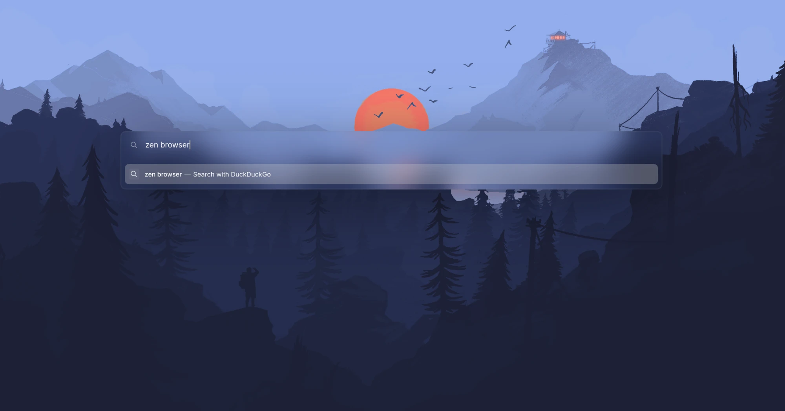

# Cleaned URL Bar Extended

A clean, glassy URL bar for [Zen Browser](https://zen-browser.app/) where **everything about the
URL bar can be personalised**: its look (colours, transparency, blur, fonts, sizes, icons) and its
behaviour (floating or not, which suggestions appear, how many results, how addresses are shown...),
including the URL bar options that normally only exist in `about:config`.



It started as a fork of [Zen Cleaned URL Bar](https://github.com/dinnoyow/zen-cleaned-url-bar), which
is no longer maintained, and builds on the fixes of
[Better Cleaned URL Bar](https://github.com/matteo-tafuro/zen-better-cleaned-url-bar) (see [Credits](#credits)).

## Install

Close Zen, then run in a terminal (Linux or macOS):

```sh
curl -fsSL https://raw.githubusercontent.com/andres-pixel35/zen-cleaned-url-bar-extended/main/install.sh | bash
```

That's all: the script finds your Zen profile and installs the look of the URL bar (the mod), keeping
any settings you already had. Then it asks whether you also want to set the URL bar's behaviour
(floating mode, which suggestions appear...); if you answer yes it asks those questions right away and
saves your answers. Pass `--configure` to go straight to the questions, or `--no-configure` to skip
them, and nothing is asked. Start Zen and the new URL bar appears a moment after startup.

Nothing that the script downloads stays on your computer: it is downloaded to a temporary folder that
is deleted when the script ends (also when it fails or you cancel it). What stays is only what Zen
uses, see [What is kept on your computer](#what-is-kept-on-your-computer).

If you use several Zen profiles (or Zen and Zen Twilight), the script asks which one to use. To
choose the profile yourself, pass its folder with `-p` (in Zen: `about:support` > **Profile
Directory**):

```sh
curl -fsSL https://raw.githubusercontent.com/andres-pixel35/zen-cleaned-url-bar-extended/main/install.sh | bash -s -- -p "/path/to/your/profile"
```

`-p` also accepts the Zen folder that contains `profiles.ini` (for example `~/.zen`).

If you used the original Cleaned URL Bar or Better Cleaned URL Bar, remove or disable it in Settings >
Zen Mods: both style the same elements, so they would fight each other. (Your old settings are not
reused; this mod has its own.)

### Update, configure, uninstall

| What | Command |
|---|---|
| Update the look and the behaviour settings, only what changed (keeps your settings) | `curl -fsSL https://raw.githubusercontent.com/andres-pixel35/zen-cleaned-url-bar-extended/main/update.sh \| bash` |
| Answer questions about the URL bar's behaviour | `curl -fsSL https://raw.githubusercontent.com/andres-pixel35/zen-cleaned-url-bar-extended/main/configure.sh \| bash` |
| Show the current behaviour settings | `curl -fsSL https://raw.githubusercontent.com/andres-pixel35/zen-cleaned-url-bar-extended/main/configure.sh \| bash -s -- --list` |
| Uninstall | `curl -fsSL https://raw.githubusercontent.com/andres-pixel35/zen-cleaned-url-bar-extended/main/uninstall.sh \| bash` |
| Uninstall and put the URL bar preferences back to Zen's defaults | `curl -fsSL https://raw.githubusercontent.com/andres-pixel35/zen-cleaned-url-bar-extended/main/uninstall.sh \| bash -s -- --reset-prefs` |

Every script accepts `-p <folder>` and `--help`. You can also clone the repository and run the
scripts directly (`./install.sh`, `./configure.sh`, ...).

**Zen must be closed** while a script changes something: Zen rewrites its settings files when it quits,
which would undo the changes. If Zen is open, the script asks you to close it and waits.

The scripts find profiles in these places: `~/.zen` and `~/.config/zen` (Linux),
`~/.var/app/app.zen_browser.zen/` (Flatpak) and `~/Library/Application Support/zen` (macOS).

`update.sh` keeps both parts up to date:

- **The look**: it compares the installed `chrome.css` and `preferences.json` with the latest ones and
  replaces them only when they differ.
- **The behaviour settings** that `configure.sh` saved: if Zen renamed one of those preferences, your
  value is moved to the new name (a value you already saved under the new name is kept). If questions
  were added since you last answered them, it lists them and offers to ask just those; without a
  terminal it tells you to run `configure.sh`. (`configure.sh` itself is never stored: it is downloaded
  fresh each time, so its questions are always the latest.)

When there is nothing to do it changes nothing, and Zen may stay open.

<details>
<summary>Windows, or installing by hand</summary>

The scripts are for Linux and macOS. On Windows (or to do it yourself):

1. In Zen open `about:support` and open the **Profile Directory**. Close Zen.
2. Create the folder `chrome/zen-themes/zen-cleaned-url-bar-extended` inside the profile and copy
   `chrome.css` and `preferences.json` from this repository into it.
3. Open `zen-themes.json` in the profile (create it with `{}` if it does not exist) and add the content
   of [`theme.json`](theme.json) as a new entry with the key `"zen-cleaned-url-bar-extended"` and an
   extra `"enabled": true`.
4. Start Zen, open `about:config`, delete `zen.mods.last-update` and restart Zen: Zen rebuilds its mod
   stylesheet at the next start when that preference is missing. (Changing any setting of any mod in
   Settings > Zen Mods also rebuilds it, without a restart.)
</details>

## Requirements

### Zen Browser

**Zen 1.16b or newer** (Firefox 143 or newer) on Linux or macOS. **Everything** (every look option and
every behaviour question) needs **Zen 1.23.3b or newer**. Older versions lack some of Zen's buttons and
preferences, so those options simply do nothing there:

| Zen version | Look (mod settings) | Behaviour questions with no effect (the preference does not exist yet) |
|---|---|---|
| 1.15.5b and older | **Not supported**: before Firefox 143 the URL bar's background element has another name | - |
| 1.16b | All except hiding the site data, split view and copy URL buttons (Zen does not have them yet) | `zen.urlbar.open-on-startup`, `zen.urlbar.show-pip-button`, `zen.urlbar.show-contextual-id`, `zen.urlbar.single-toolbar-show-copy-url`, `browser.urlbar.closeOnWindowBlur`, `browser.urlbar.trimWww`, `browser.urlbar.share-button.enabled`, `browser.urlbar.shortcuts.workspaces`, `zen.theme.acrylic-urlbar`, `zen.urlbar.show-pinned`, `zen.urlbar.show-sponsored` |
| 1.17b | All except hiding the split view button | the same, except `zen.urlbar.show-contextual-id`, which works |
| 1.18b, 1.19.9b, 1.21b | All | in 1.19.9b: `browser.urlbar.trimWww`, `browser.urlbar.share-button.enabled`, `browser.urlbar.shortcuts.workspaces`, `zen.theme.acrylic-urlbar`, `zen.urlbar.show-pinned`, `zen.urlbar.show-sponsored` |
| 1.22b, 1.23b | All | `zen.theme.acrylic-urlbar` (added in 1.23.1b), `zen.urlbar.show-pinned` and `zen.urlbar.show-sponsored` (added in 1.23.3b) |
| 1.23.3b, 1.23.4b | All | none |

A version between two rows works at least as well as the row above it: Zen and Firefox only added
these buttons and preferences over time, never removed them.

How this was checked: on the Linux builds of Zen 1.15.5b, 1.16b, 1.17b, 1.18b, 1.19.9b, 1.21b, 1.22b,
1.23b and 1.23.4b, `install.sh` was run on a fresh profile, Zen was started (it applied the mod by
itself), and every look option was set and read back from the real URL bar; the blur was also checked
on screen. Which preferences exist was read from the 1.16b, 1.17b, 1.19.9b, 1.22b, 1.23b and 1.23.4b
builds; the versions that added `zen.theme.acrylic-urlbar`, `zen.urlbar.show-pinned` and
`zen.urlbar.show-sponsored` come from Zen's source code. Zen versions newer than 1.23.4b
were not available to test: Zen changes its URL bar now and then, so a future version may need an
update of this mod.

### For the scripts

Nothing to install on macOS or on a normal Linux desktop: everything below comes with the system.
No jq, python, node or root access is needed, and nothing is installed system-wide.

| Tool | Linux package | Used for |
|---|---|---|
| `bash` 3.2 or newer (macOS's built-in bash works) | `bash` | running the scripts |
| `curl` | `curl` | downloading the project (only when run with `curl ... \| bash`) |
| `tar` and `gzip` | `tar`, `gzip` | unpacking that download |
| `awk` (any: gawk, mawk, busybox or BSD awk) | `gawk` or `mawk` | reading `profiles.ini`, `zen-themes.json` and `prefs.js` |
| `sed`, `grep` | `sed`, `grep` | small text edits and checks |
| `cat`, `cp`, `mv`, `rm`, `mkdir`, `mktemp`, `chmod`, `ls`, `tr`, `dirname`, `readlink`, `uname` | `coreutils` | file handling |
| `pgrep` (or `ps`) | `procps` / `procps-ng` | telling whether Zen is running |
| `lsof` (macOS only, built in) | - | telling whether Zen is running on macOS |

The mod itself needs nothing: Zen loads it with its own mod system.

### What is kept on your computer

Only what Zen uses, all inside your Zen profile:

- `chrome/zen-themes/zen-cleaned-url-bar-extended/chrome.css` and `preferences.json`: the look of the
  URL bar and the list of its settings.
- The mod's entry in `zen-themes.json` (Zen's list of installed mods).
- Your settings, in Zen's `prefs.js`: the mod's own (`mod.cleanedurlbarext.*`) and any URL bar
  preference you changed (those are normal Zen preferences). One of the mod's,
  `mod.cleanedurlbarext.questions-seen`, is just a number: the latest set of behaviour questions you
  were asked, so `update.sh` knows which ones are new.
- `prefs.js.cleanedurlbarext.bak` and `zen-themes.json.cleanedurlbarext.bak`: a copy of those two files
  from before the last change a script made, in case you need to undo it. There is only ever one copy
  of each (every run replaces it), so they take about as much space as the files themselves: usually
  a few tens of KB for `prefs.js` and around 1 KB for `zen-themes.json`.

The scripts themselves (`install.sh`, `configure.sh`, ...) are not kept: with `curl ... | bash` they
are downloaded to a temporary folder that is deleted when they finish. `uninstall.sh` removes the mod
folder, its entry, its `mod.cleanedurlbarext.*` settings and the two backups (it only keeps the URL bar
preferences you changed, unless you pass `--reset-prefs`).

## Customise

### Look: Settings > Zen Mods > Cleaned URL Bar Extended


Every look option is in Zen's mod settings and applies instantly. A text field that shows
**Zen default** keeps Zen's own style while it is empty, so you only change what you want.

- **A CSS colour** can be written as hex (`#ff8800`), `rgb(255 136 0)`, `hsl(32 100% 50%)` or a name
  (`orange`, `white`). For a see-through colour add the opacity: `rgb(255 136 0 / 50%)` or `#ff880080`.
- **A size** is a number with a unit: `12px` (pixels) or `1.2em` (relative to the text size); some
  options also take `%`, as noted.
- A value that is not valid CSS does **not** fall back to Zen's style: that part resets to a plain
  default instead (for example no border at all, or plain black or white text). If something looks
  wrong, check the value, or empty the field to get Zen's style back.

| Setting | What to enter | Default |
|---|---|---|
| Panel · Background | **Zen accent colour**, **Custom colours** (the two colour fields below) or **Zen default** (Zen's own background) | Zen accent colour |
| Panel · Background transparency | A percentage: `0%` solid, `100%` invisible. Used with the accent and custom colours | `90%` |
| Panel · Custom colour, dark theme | A CSS colour (see above), e.g. `#1a1a1a`. Used when Background is Custom and Zen's theme is dark | `hsl(0 0 10)` |
| Panel · Custom colour, light theme | A CSS colour (see above), e.g. `#e6e6e6`. Used when Background is Custom and Zen's theme is light | `hsl(0 0 90)` |
| Panel · Background blur | A size, e.g. `25px`. `0px` or empty = no blur | `25px` |
| Panel · Corner radius | A size, e.g. `15px`. `0px` = square corners | `15px` |
| Panel · Border | A CSS border: width, style and colour, e.g. `2px solid #808080` or `1px dashed rgb(255 255 255 / 30%)`. `none` = no border | `3px solid hsl(0 0 50 / 10%)` |
| Panel · Remove the drop shadow | On or off | off |
| Panel · Remove the line between the text field and the results | On or off | on |
| Panel · Width when floating | A size: a percentage of the window, e.g. `60%`, or pixels, e.g. `800px`. Only while the bar floats | empty (Zen's style) |
| Panel · Distance from the top when floating | A size: a percentage of the window height, e.g. `20%`, or pixels, e.g. `150px`. Only while the bar floats | empty (Zen's style) |
| Panel · Font | The name of a font installed on your computer, e.g. `Inter` or `JetBrains Mono` (several, separated by commas, are tried in order: `JetBrains Mono, monospace`), or `sans-serif`, `serif`, `monospace` | empty (Zen's style) |
| Panel · Typed text size | A size, e.g. `18px` or `1.2em` | empty (Zen's style) |
| Panel · Typed text colour | A CSS colour (see above), e.g. `#ffffff` | empty (Zen's style) |
| Results · Row corner radius | A size, e.g. `11px`. `0px` = square rows | `11px` |
| Results · Fade the highlight in and out smoothly | On or off | on |
| Results · Row height | A size, e.g. `38px`. Zen uses `45px`; smaller makes the list compact | empty (Zen's style) |
| Results · List height before scrolling | A size, e.g. `400px`, or `none` for no limit. Zen uses `244px` (about five rows) | empty (Zen's style) |
| Results · Text size | A size, e.g. `13px` or `0.9em`. Zen uses `14px` | empty (Zen's style) |
| Results · Title colour | A CSS colour (see above) for the page titles of the rows that are not selected, e.g. `#e0e0e0` | empty (Zen's style) |
| Results · Address colour | A CSS colour (see above) for the addresses of the rows that are not selected, e.g. `#9a9a9a` | empty (Zen's style) |
| Results · Hover background | A CSS colour (see above) for the row under the mouse; a see-through one works best, e.g. `rgb(255 255 255 / 10%)` | empty (Zen's style) |
| Results · Dim addresses to make titles stand out | On or off | on |
| Results · Hide addresses, show titles only | On or off | off |
| Selected result · Background | **Zen accent colour (softened)**, **Custom colour** (the field below) or **Zen default** | Zen accent colour (softened) |
| Selected result · Background transparency | A percentage: `0%` solid, `100%` invisible | `70%` |
| Selected result · Custom background colour | A CSS colour (see above), e.g. `#5050fa`. Used when Background is Custom | `hsl(0 0 80)` |
| Selected result · Text colour | A CSS colour (see above) for the text of the selected row, e.g. `#ffffff`. Works with any background | empty (Zen's style) |
| Selected result · Icon background | **Subtle tint**, **None** or **Zen default** (a white tile) | Subtle tint |
| Resting bar · Background colour | A CSS colour (see above), e.g. `rgb(255 255 255 / 8%)` | empty (Zen's style) |
| Resting bar · Corner radius | A size, e.g. `10px` | empty (Zen's style) |
| Resting bar · Border | A CSS border, e.g. `1px solid #808080` | empty (Zen's style) |
| Resting bar · Font | The name of an installed font, e.g. `Inter`, or `sans-serif`, `serif`, `monospace` | empty (Zen's style) |
| Resting bar · Text size | A size, e.g. `14px` or `1em` | empty (Zen's style) |
| Resting bar · Text colour | A CSS colour (see above), e.g. `#cccccc` | empty (Zen's style) |
| Resting bar · Centre the address | On or off | off |
| Icons · Hide the site information | On or off | off |
| Icons · Hide Zen's site data / extensions button | On or off | off |
| Icons · Hide granted-permission icons | On or off | off |
| Icons · Show the reader view button | On or off | off |
| Icons · Show the bookmark star | On or off | off |
| Icons · Hide the zoom level indicator | On or off | off |
| Icons · Hide the translations button | On or off | off |
| Icons · Hide the split view button | On or off | off |
| Icons · Hide the copy URL button | On or off | off |
| Search buttons row · Rounded, borderless style | On or off. The row only shows when Zen's "hide the search-engine buttons row" is off | on |

The panel is the URL bar while it is open (expanded in place or floating); the resting bar is the
URL bar when it is not focused (in the sidebar or the top toolbar).

### Behaviour: `configure.sh` or Zen's mod settings

The URL bar's behaviour comes from Zen's own preferences (the ones in `about:config`). The mod puts
the on/off and choice ones in its settings page too (below the look options), and `configure.sh` asks
about all of them, including the numbers Zen's settings page cannot edit (how many results, delays...).
These are normal Zen preferences: they stay when the mod is disabled or removed, unless you uninstall
with `--reset-prefs`.

<details>
<summary>All behaviour preferences</summary>

**Opening and behaviour**

| Preference | Zen default | Where |
|---|---|---|
| `zen.urlbar.behavior`: How should the URL bar open? | Float when opened with the keyboard (Ctrl+L, Ctrl+T), expand in place when clicked | configure.sh, Zen settings |
| `zen.urlbar.replace-newtab`: Open the URL bar instead of a blank page when you open a new tab? | on | configure.sh, Zen settings |
| `zen.urlbar.wait-to-clear`: How long, in milliseconds, should Zen remember what you typed in a new-tab URL bar you dismissed? | 45000 | configure.sh |
| `zen.urlbar.open-on-startup`: Open the URL bar automatically when Zen starts on an empty tab? | on | configure.sh, Zen settings |
| `browser.urlbar.openintab`: Open what you pick in the URL bar in a new tab instead of the current one? | off | configure.sh, Zen settings |
| `browser.urlbar.switchTabs.adoptIntoActiveWindow`: When a "Switch to tab" result belongs to another window, move that tab into the current window? | off | configure.sh, Zen settings |
| `zen.urlbar.enable-overrides`: Let Shift, Alt or Ctrl change what the selected result does? | off | configure.sh, Zen settings |
| `browser.urlbar.closeOnWindowBlur`: Close the URL bar dropdown when the Zen window loses focus? | off | configure.sh, Zen settings |
| `browser.urlbar.focusContentDocumentOnEsc`: Move focus back to the page when you press Esc in an empty URL bar? | on | configure.sh, Zen settings |

**Address display**

| Preference | Zen default | Where |
|---|---|---|
| `zen.urlbar.show-domain-only-in-sidebar`: In the single-toolbar layout, show only the domain (example.com) instead of the full address? | on | configure.sh, Zen settings |
| `browser.urlbar.trimURLs`: Hide "http://" and trailing slashes in addresses? | on | configure.sh, Zen settings |
| `browser.urlbar.trimHttps`: Also hide "https://"? | on | configure.sh, Zen settings |
| `browser.urlbar.trimWww`: Hide a leading "www."? | off | configure.sh, Zen settings |
| `browser.urlbar.untrimOnUserInteraction.featureGate`: Show the full address (with https://) as soon as you click into the URL bar? | on | configure.sh, Zen settings |
| `browser.urlbar.decodeURLsOnCopy`: Copy addresses in readable form (for example a space instead of %20)? | off | configure.sh, Zen settings |

**Buttons and icons**

| Preference | Zen default | Where |
|---|---|---|
| `zen.urlbar.show-protections-icon`: Show the tracking-protection shield icon? | off | configure.sh, Zen settings |
| `zen.urlbar.show-pip-button`: Show the Picture-in-Picture button when a page plays video? | off | configure.sh, Zen settings |
| `zen.urlbar.show-contextual-id`: Show the container label when a tab is in a container? | off | configure.sh, Zen settings |
| `zen.urlbar.single-toolbar-show-copy-url`: Show the "Copy URL" button in the single-toolbar layout? | on | configure.sh, Zen settings |
| `browser.urlbar.share-button.enabled`: Show the Share button? | off | configure.sh, Zen settings |
| `zen.theme.acrylic-urlbar`: Use Zen's own frosted-glass background for the open URL bar? | off | configure.sh, Zen settings |

**Suggestions**

| Preference | Zen default | Where |
|---|---|---|
| `browser.urlbar.suggest.history`: Suggest pages from your browsing history? | on | configure.sh, Zen settings |
| `browser.urlbar.suggest.bookmark`: Suggest bookmarks? | on | configure.sh, Zen settings |
| `browser.urlbar.suggest.openpage`: Suggest tabs you already have open ("Switch to tab")? | on | configure.sh, Zen settings |
| `browser.urlbar.suggest.remotetab`: Suggest tabs open on your other synced devices? | on | configure.sh, Zen settings |
| `zen.urlbar.show-pinned`: When the URL bar is empty, include your pinned shortcuts? | on | configure.sh, Zen settings |
| `zen.urlbar.show-sponsored`: When the URL bar is empty, include sponsored shortcuts? | off | configure.sh, Zen settings |
| `browser.urlbar.suggest.engines`: Suggest search engines whose name or keyword matches what you type (tab-to-search)? | on | configure.sh, Zen settings |
| `browser.urlbar.suggest.clipboard`: Suggest the link you just copied? | on | configure.sh, Zen settings |
| `browser.urlbar.suggest.calculator`: Show a calculator result when you type a math expression? | on | configure.sh, Zen settings |
| `browser.urlbar.unitConversion.enabled`: Show unit conversions (for example "10 km to mi")? | on | configure.sh, Zen settings |
| `browser.urlbar.suggest.recentsearches`: Suggest your recent searches when the URL bar is empty? | on | configure.sh, Zen settings |
| `browser.urlbar.recentsearches.maxResults`: How many recent searches should be shown at most? | 5 | configure.sh |
| `browser.urlbar.quickactions.enabled`: Enable Firefox quick actions (for example "Settings", "Clear history", "Downloads")? | on | configure.sh, Zen settings |
| `browser.urlbar.suggest.quickactions`: Show quick actions among normal results? | on | configure.sh, Zen settings |
| `zen.urlbar.suggestions.quick-actions`: Suggest Zen commands (for example "Toggle compact mode", "New split view")? | on | configure.sh, Zen settings |
| `browser.urlbar.contextualSearch.enabled`: Offer to search the current site when it has its own search engine? | on | configure.sh, Zen settings |
| `browser.urlbar.autoFill`: Autocomplete addresses inline as you type? | on | configure.sh, Zen settings |
| `browser.urlbar.groupLabels.enabled`: Show group headings above kinds of results? | off | configure.sh, Zen settings |
| `browser.urlbar.deduplication.enabled`: Merge history results that only differ by their #anchor? | on | configure.sh, Zen settings |
| `browser.urlbar.maxRichResults`: How many results should the dropdown show at most? | 10 | configure.sh |

**Search**

| Preference | Zen default | Where |
|---|---|---|
| `keyword.enabled`: Search with your default engine when what you type is not an address? | on | configure.sh, Zen settings |
| `browser.search.suggest.enabled`: Ask your search engine for suggestions as you type? | off | configure.sh, Zen settings |
| `browser.urlbar.suggest.searches`: Show those search suggestions in the URL bar? | on | configure.sh, Zen settings |
| `browser.urlbar.showSearchSuggestionsFirst`: Show search suggestions above history and bookmarks? | on | configure.sh, Zen settings |
| `browser.search.suggest.enabled.private`: Also show search suggestions in private windows? | off | configure.sh, Zen settings |
| `browser.urlbar.richSuggestions.tail`: Show "tail" suggestions that complete only the end of a long query? | on | configure.sh, Zen settings |
| `browser.formfill.enable`: Remember search and form history? | off | configure.sh, Zen settings |
| `browser.urlbar.maxHistoricalSearchSuggestions`: How many of your past searches should be suggested at most? | 2 | configure.sh |
| `zen.urlbar.hide-one-offs`: Hide the row of search-engine buttons at the bottom of the dropdown? | on | configure.sh, Zen settings |
| `browser.urlbar.shortcuts.bookmarks`: Show a "search bookmarks" button in that row? | on | configure.sh, Zen settings |
| `browser.urlbar.shortcuts.tabs`: Show a "search tabs" button in that row? | on | configure.sh, Zen settings |
| `browser.urlbar.shortcuts.history`: Show a "search history" button in that row? | on | configure.sh, Zen settings |
| `browser.urlbar.shortcuts.workspaces`: Show a "search workspaces" button in that row? | on | configure.sh, Zen settings |
| `browser.fixup.dns_first_for_single_words`: Treat a single word (like "router") as a local host name before searching for it? | off | configure.sh, Zen settings |
| `browser.urlbar.dnsResolveSingleWordsAfterSearch`: After you search a single word, check if it is also a local host and offer "Did you mean to go to ..."? | Never | configure.sh |

**Advanced**

| Preference | Zen default | Where |
|---|---|---|
| `browser.urlbar.speculativeConnect.enabled`: Pre-connect to the likely destination while you type? | on | configure.sh, Zen settings |
| `browser.urlbar.ctrlCanonizesURLs`: Make Ctrl+Enter turn "example" into "www.example.com"? | on | configure.sh, Zen settings |
| `browser.urlbar.delay`: How long, in milliseconds, to wait after you stop typing before updating results? | 50 | configure.sh |

</details>

Notes:
- Some preferences only matter together, and `configure.sh` skips questions that do not apply (for
  example search suggestions need `browser.search.suggest.enabled`, which Zen turns off by default).
- Hiding or showing the search-engine buttons row (`zen.urlbar.hide-one-offs`) takes effect after a
  restart of Zen.
- Zen locks a few URL bar preferences (sponsored "quick suggest" results and top-site suggestions), and
  turns off the services behind others (trending searches, weather, Firefox Suggest), so they are not
  offered here.

## How it works

- Zen loads mods from `chrome/zen-themes/<id>/` inside your profile and lists them in
  `zen-themes.json`. The installer puts the mod there and registers it.
- Zen only rebuilds its combined mod stylesheet (`chrome/zen-themes.css`) when a mod changes, or when
  its mod-update check runs at startup, which happens whenever `zen.mods.last-update` is unset. The
  scripts clear it, so the change shows up a moment after the next start. (That check also looks for
  updates of your other mods, as Zen does on its own every few weeks.)
- The mod's options are preferences named `mod.cleanedurlbarext.*`. Zen writes their default
  values; Zen's settings page then edits them. Text options reach the CSS as variables, and every
  rule is wrapped in `@media -moz-pref(...)`, which is why an empty field means "Zen default".
- Before changing `prefs.js` or `zen-themes.json` the scripts save a copy next to them, ending in
  `.cleanedurlbarext.bak`. `uninstall.sh` deletes those copies once it has finished successfully.
- This mod is not in Zen's theme store, so Zen's automatic mod updates do not touch it; use
  `update.sh` to update.

## What's fixed compared to the original

- **Blur works again** on Zen 1.19.9b and newer (Firefox 150+), which stopped `backdrop-filter` from
  seeing the page behind the URL bar. The fix (found by matteo-tafuro) is only applied while a blur is
  set.
- **Selectors updated** for current Zen: `.urlbar-background` (was `#urlbar-background`) and
  `[breakout-extend]` without a value (Zen 1.21.2b+), also from matteo-tafuro's fork.
- **The line between the text field and the results is removed again**: Firefox 158 (Zen 1.23.3b)
  moved it from `.urlbarView-body-inner`, where the original removed it, to `.urlbarView-results`;
  both are handled now.
- **Dark mode colours follow Zen's theme**: the custom colours use `light-dark()`, so they follow the
  theme chosen in Zen even when it differs from the system theme (`prefers-color-scheme` does not).
- **Icons on a selected result stay readable** with the subtle or transparent icon background (Zen
  paints them in a dark colour meant for its white tile).
- **No dependency on the mod's display name**: options use `-moz-pref()` instead of the hidden element
  Zen names after the mod, and the Zen-only `-moz-bool-pref` is no longer needed.
- **Settings take effect right after installing**, instead of only after Zen happens to rebuild its
  mod stylesheet.

## Development

```sh
tests/test_scripts.sh [bash] [awk]   # the scripts against fake Zen folders (try /bin/bash 3.2 and original-awk)
python3 tests/test_consistency.py    # preferences.json, catalogue, chrome.css and theme.json agree
python3 tests/fuzz_json_awk.py       # the awk JSON helper against Python's json module
```

`lib/catalogue.txt` lists the behaviour questions; every on/off or choice preference there must also be
in `preferences.json` (the consistency test checks it). A new question gets the next `since` revision,
so `update.sh` offers it to existing users. When Zen renames a preference, keep the question under the
new name and add `@renamed|<old>|<new>`, so saved values are moved. Remember to raise `version` in
`theme.json` for a release.

## Credits

- [DinnoDEV / dinnoyow](https://github.com/dinnoyow/zen-cleaned-url-bar): the original Zen Cleaned URL
  Bar, its design and options.
- [KennethThomson](https://github.com/KennethThomson): light and dark mode colours in the original
  (dinnoyow/zen-cleaned-url-bar#14).
- [matteo-tafuro](https://github.com/matteo-tafuro/zen-better-cleaned-url-bar): Better Cleaned URL
  Bar, which restored the blur and the selectors on recent Zen versions and added the accent colour
  modes, blur amount, selected-result opacity, dimmed URLs, favicon background and smooth transitions
  that this mod keeps.

Released under the [MIT License](LICENSE).
